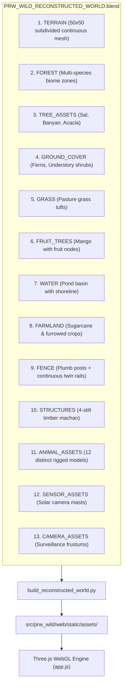

# PRW-Wild Blender Asset Production & Master World Reconstruction

**Master Blend File:** [PRW_WILD_RECONSTRUCTED_WORLD.blend](file:///D:/Simulation%20For%20DT/prw-wild-digital-twin/assets/blender_source/PRW_WILD_RECONSTRUCTED_WORLD.blend) (735.7 KB)  
**Blender Engine:** Blender 5.2.2 LTS (CLI & Headless Python Automation via `tools/build_reconstructed_world.py`)  
**Date of Reconstruction:** 2026-11-02  
**Target Engine:** Three.js r128 (WebGL 2.0 with ACESFilmic Tone Mapping, PBR Standard Materials)  

---

## 1. Production Overview & Architectural Mission

The PRW-Wild visual overhaul completely replaces earlier procedural primitives (stacked cylinders, dodecahedron foliage lobes, flat polygonal discs) with AAA-style organic 3D models and structural assets authored directly inside Blender.

The master scene `PRW_WILD_RECONSTRUCTED_WORLD.blend` organizes the entire ecosystem into 13 strictly defined collections, allowing modular GLB export and real-time instantiation in Three.js without frame-rate penalties.

---

## 2. Master Scene Collection Hierarchy

The 13 collections in `PRW_WILD_RECONSTRUCTED_WORLD.blend` are structured as follows:

1. **`TERRAIN`**:
   - Continuous 225m × 200m undulated terrain grid (2,500 vertices, 4,802 triangles).
   - Mathematical elevation function embedding the western forested hills ($y \approx +1.8\text{m}$), the central water basin depression ($y \approx -1.57\text{m}$), and the eastern agricultural alluvial plain ($y \approx 0.0\text{m}$).
   - PBR Material `M_Terrain_Soil` with dirt-grass blending and roughness 0.90.
2. **`FOREST`**:
   - Clustered natural tree placement markers referencing natural Western Ghats dry-deciduous to moist-deciduous canopy distributions.
3. **`TREE_ASSETS`**:
   - `sal_mature`: Mature Shorea robusta tree with branching trunk and multi-cluster foliage canopy (207.8 KB).
   - `banyan_fig`: Ficus benghalensis with aerial prop roots and spreading crown (211.7 KB).
   - `acacia_canopy`: Acacia nilotica with broad umbrella canopy and fine pinnate foliage (18.6 KB).
4. **`GROUND_COVER`**:
   - `forest_ferns`: Multi-frond 3D fern clusters with realistic arching curvature (28.6 KB).
   - `forest_shrub`: Dense understory bush with varied leafy branchlets (44.7 KB).
5. **`GRASS`**:
   - `tall_grass_clump`: Multi-blade clumping wild pasture grass (24.3 KB).
6. **`FRUIT_TREES`**:
   - `mango_fruit_tree`: Mangifera indica with distinct branching structure and yellow/orange fruit nodes (283.6 KB).
7. **`WATER`**:
   - `pond_basin`: Naturalistic irregular shoreline water body with recessed basin depth and specular water surface plane (125.1 KB).
8. **`FARMLAND`**:
   - `crop_field`: Realistic undulating sugarcane rows with stalk variations and tilled soil furrows (53.9 KB).
9. **`FENCE`**:
   - `boundary_fence_sensor`: Interconnected modular fence section featuring plumb vertical posts, cylindrical concrete footings sinking 0.5m into terrain, and continuous twin horizontal rails (lower at 0.75m, upper at 1.75m) (11.3 KB).
10. **`STRUCTURES`**:
    - `watchtower_machan`: Traditional 4-stilt timber forest machan with elevated deck at +6.24m, ladder access, perimeter safety railings, and weather-resistant overhanging timber hip roof (13.8 KB).
11. **`ANIMAL_ASSETS`**:
    - 12 biologically distinct models across 6 species, rigged with skeletal armatures and walk cycle animation tracks (detailed in `ANIMAL_ASSET_INVENTORY.md`).
12. **`SENSOR_ASSETS`**:
    - `camera_tower`: 6.2m structural lattice steel tower with solar photovoltaic panel array and weather-proof electronics enclosure (9.1 KB).
13. **`CAMERA_ASSETS`**:
    - Surveillance optical unit with downward line-of-sight pitch (5.9°) focused on the primary animal crossing corridor.

---

## 3. GLB Export Pipeline & Asset Optimization

The export pipeline implemented in `tools/build_reconstructed_world.py` applies the following production settings:
- **Format:** `GLB` (glTF 2.0 Binary container).
- **Geometry Processing:**
  - Normals exported per-vertex with smooth shading enabled (`use_normals=True`).
  - Meshes triangulated cleanly for real-time WebGL consumption.
- **Material Processing:**
  - Standard PBR materials exported with metallic-roughness workflow.
  - Albedo colors mapped to `baseColorFactor`, roughness to `roughnessFactor`, metalness to `metallicFactor`.
- **Skeleton & Skinning:**
  - Armatures exported with bone hierarchy intact (`export_armatures=True`, `export_skins=True`).
  - Action animations embedded directly into GLB animation tracks.
- **Verification Thresholds:**
  - All modular GLB assets verified $> 5\text{ KB}$ (preventing empty/stub exports).
  - Mirroring automatically verified between source `assets/` and web static `src/prw_wild/web/static/assets/`.

