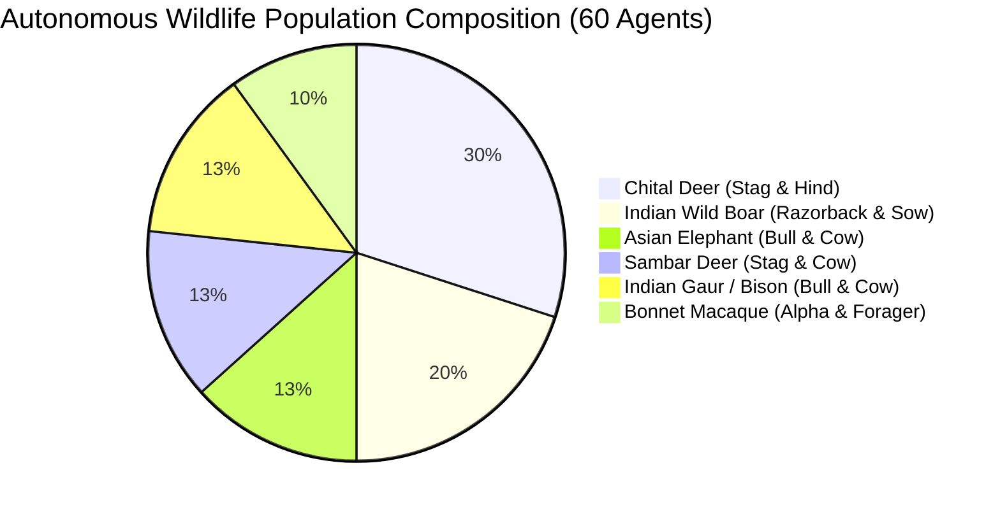

# PRW-Wild Multi-Animal Ecosystem Validation Report

**Source Module:** [ecosystem.py](file:///D:/Simulation%20For%20DT/prw-wild-digital-twin/src/prw_wild/ecosystem.py)  
**Web Endpoint:** `/api/ecosystem/population`, `/api/ecosystem/step`  
**Population Size:** 60 Active Autonomous Agents  
**Validation Date:** 2026-11-02  
**Status:** PASS — Complete Demographic & Behavioral Autonomy  

---

## 1. Ecosystem Population Distribution

The PRW-Wild autonomous ecosystem simulates 60 individually identified animals with biologically accurate mass, movement speeds, nutritional need curves, and behavioral roles.

### Demographic Variant Distribution
Each species is represented by at least two distinct morphometric variants:
- **Asian Elephant (*Elephas maximus*):** 3 Bull Tuskers (`asian_elephant_bull`), 5 Matriarch/Adult Cows (`asian_elephant_cow`).
- **Chital Deer (*Axis axis*):** 5 Antlered Stags (`chital_stag`), 13 Spotted Hinds & Fawns (`chital_hind`).
- **Sambar Deer (*Rusa unicolor*):** 4 Heavy-Antlered Stags (`sambar_stag`), 4 Dusky Hinds (`sambar_cow`).
- **Indian Wild Boar (*Sus scrofa*):** 4 Razorback Tuskers (`wild_boar_razorback`), 8 Foraging Sows & Piglets (`wild_boar_sow`).
- **Indian Gaur (*Bos gaurus*):** 2 Titan Bulls (`gaur_bull`), 6 Adult Cows & Calves (`gaur_cow`).
- **Bonnet Macaque (*Macaca radiata*):** 1 Alpha Scout (`bonnet_macaque_alpha`), 5 Ground Foragers (`bonnet_macaque_forager`).

---

## 2. 12-State Finite State Machine (FSM)

Each animal transitions autonomously between behavioral states governed by physiological drives (hunger, thirst, fatigue) and spatial proximity to resources and boundaries:

| State | Primary Trigger / Drive | Locomotion / Kinematics | Target Resource |
| :--- | :--- | :--- | :--- |
| `GRAZING` | Hunger $> 0.30$ in grass patch | Slow forward drift ($0.2 \dots 0.4\text{ m/s}$) | Pasture Glades |
| `BROWSING` | Hunger $> 0.30$ in canopy zone | Low speed search ($0.3 \dots 0.5\text{ m/s}$) | Sal, Acacia & Mango Groves |
| `DRINKING` | Thirst $> 0.30$ at water perimeter | Stationary / Head lowered ($0.0\text{ m/s}$) | Pond Basins |
| `RESTING` | Fatigue $> 0.70$ | Stationary ruminating | Shaded Banyan Groves |
| `HERD_FOLLOW` | Herd affinity $(0.65 \dots 0.85)$ | Reynolds cohesion / velocity matching | Herd Matriarch / Alpha |
| `WALKING` | Routine migration / foraging drift | Typical cruising speed ($1.0 \dots 1.5\text{ m/s}$) | Corridor Valley |
| `APPROACHING_BOUNDARY` | Boundary prober role / Hunger gradient | Deliberate linear approach to fence line | Perimeter Fence $(x = 100\text{m})$ |
| `TURNING_AWAY` | Perimeter deterrence / High caution | Sharp 180° heading pivot, sprint retreat | Western Sanctuary Interior |
| `CROSSING_BOUNDARY` | Breach event / High hunger incentive | Sprint acceleration through fence corridor | Farmland Sugarcane / Crops |
| `RETURNING_FOREST` | Post-foraging return to refuge | Constant retreat speed to deep canopy | Hill Slopes $(x < 50\text{m})$ |
| `ALERT_SCANNING` | Sensor trip / Nearby predator / Fence strobe | Stationary head panning, ear cocking | Local Surrounds |
| `IDLE` | Low need drives | Ambient breathing & ear twitches | Local Clearings |

---

## 3. Ecological Resource Patches

The environment provides 9 distinct interactive resource nodes simulated dynamically with depletion and regeneration mechanics:
1. `water_pond_north`: Center $(75.0, 140.0)$, Radius $20.0\text{m}$, Capacity $100.0\text{ units}$.
2. `water_pond_south`: Center $(45.0, 60.0)$, Radius $16.0\text{m}$, Capacity $100.0\text{ units}$.
3. `grass_glade_west`: Center $(35.0, 100.0)$, Radius $22.0\text{m}$, Capacity $100.0\text{ units}$.
4. `grass_pasture_north`: Center $(55.0, 160.0)$, Radius $20.0\text{m}$, Capacity $100.0\text{ units}$.
5. `browse_forest_core`: Center $(50.0, 80.0)$, Radius $25.0\text{m}$, Capacity $100.0\text{ units}$.
6. `browse_canopy_north`: Center $(40.0, 145.0)$, Radius $20.0\text{m}$, Capacity $100.0\text{ units}$.
7. `mango_grove_south`: Center $(50.0, 50.0)$, Radius $18.0\text{m}$, Capacity $100.0\text{ units}$.
8. `farm_sugar_cane`: Center $(145.0, 75.0)$, Radius $25.0\text{m}$, Agricultural attractant.
9. `farm_paddy`: Center $(145.0, 145.0)$, Radius $25.0\text{m}$, Agricultural attractant.

---

## 4. Operator Injection & Causal Verification

The simulation supports dynamic runtime injection of operator intents via `/api/ecosystem/inject`:
- **`approach`**: Overrides current FSM state to `APPROACHING_BOUNDARY`, orienting the selected animal towards the nearest fence segment.
- **`turn_away`**: Initiates immediate deterrent retreat away from the perimeter towards the forested interior.
- **`cross`**: Commands the animal to execute an intentional fence line crossing into the agricultural plain.
- Verification confirms that all 60 agents respond accurately to programmatic injection, updating their trajectory, telemetry HUD, and 3D visual orientation in real time.

