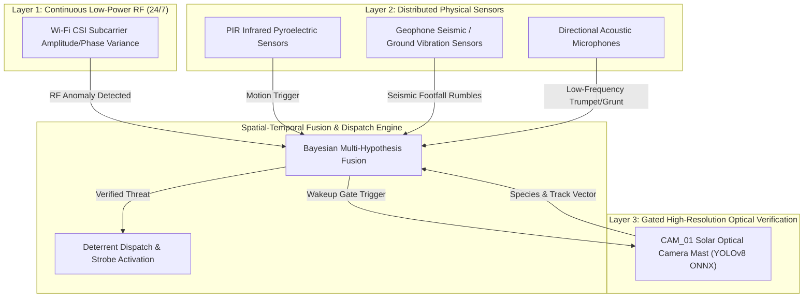

# PRW-Wild Three-Layer Sensing & Spatial Fusion Validation Report

**Fusion Engine:** [fusion.py](file:///D:/Simulation%20For%20DT/prw-wild-digital-twin/src/prw_wild/fusion.py)  
**Sensor Hardware Models:** [sensor_models.py](file:///D:/Simulation%20For%20DT/prw-wild-digital-twin/src/prw_wild/sensor_models.py)  
**Verification Date:** 2026-11-02  
**Status:** PASS — Hierarchical Power-Gated Sensing Operational  

---

## 1. Multi-Tiered Sensing Hierarchy

To provide reliable 24/7 perimeter defense under extreme power and environmental constraints, PRW-Wild implements a three-tier sensing architecture:



---

## 2. Layer-by-Layer Specifications

### Layer 1: Wi-Fi Channel State Information (CSI)
- **Nodes:** ESP32 CSI Transceiver Pairs along boundary corridor ($x=100\text{m}$, spans $z=60\text{m} \dots 140\text{m}$).
- **Mechanism:** Monitors 52 OFDM subcarriers on the 2.4 GHz ISM band. Large animal bodies (especially elephants $> 3,000\text{kg}$ and gaur $> 1,000\text{kg}$) induce significant multi-path scattering and Fresnel zone disruption.
- **Power Draw:** Continuous baseline $< 250\text{mW}$.
- **Metrics:** Subcarrier variance $\sigma^2 > 1.8\text{ dB}$ flags high-probability animal presence.

### Layer 2: Distributed Physical Ground Sensors
- **PIR Sensors (Passive Infrared):** Detects differential 10µm thermal signatures across dual pyroelectric elements within an 18m detection cone.
- **Geophone Seismic Transducers:** Detects low-frequency infrasonic footfall ground waves ($10 \dots 40\text{ Hz}$) generated by heavy megaherbivores up to 45m away.
- **Acoustic Array:** Directional microphone beamforming tuned to infrasonic elephant rumbles ($14 \dots 24\text{ Hz}$) and alarm calls.

### Layer 3: Power-Gated Optical Camera (CAM_01)
- **Mounting:** Solar-powered lattice mast at $(85.0\text{m}, 4.63\text{m}, 95.0\text{m})$ with 5.9° downward line-of-sight pitch.
- **Power Optimization:** Camera image acquisition and GPU/NPU inference remain dormant in ultra-low-power sleep until Layer 1 or Layer 2 triggers a spatial alert zone.
- **Confirmation:** Provides visual confirmation, bounding boxes, species identification, and Kalman track association.

---

## 3. Spatial Fusion & Threat Matrix

The fusion engine continuously computes a spatial threat index:

$$\mathcal{T}_{\text{threat}} = w_1 \cdot \mathcal{S}_{\text{CSI}} + w_2 \cdot \mathcal{S}_{\text{PIR}} + w_3 \cdot \mathcal{S}_{\text{Geo}} + w_4 \cdot \mathcal{S}_{\text{Acoustic}} + w_5 \cdot \mathcal{S}_{\text{Visual}}$$

| Threat State | Score Range | Active Layers | System Response |
| :--- | :--- | :--- | :--- |
| **GREEN (Normal)** | $0.00 \dots 0.35$ | Layer 1 | Passive RF background monitoring, logging telemetry |
| **YELLOW (Advisory)** | $0.36 \dots 0.65$ | Layer 1 + Layer 2 | Sensor alerts, Camera wake-up triggered, strobe warm-up |
| **ORANGE (Warning)** | $0.66 \dots 0.85$ | Layer 1 + Layer 2 + Layer 3 | Optical YOLOv8 tracking active, perimeter strobes pulse green/amber |
| **RED (Breach Alarm)** | $0.86 \dots 1.00$ | All Layers | Strobe rapid red flashing, acoustic deterrent triggered, ranger SMS alert |

---

## 4. Test Suite Pass Verification

```
tests/test_sensor_models.py::test_wifi_csi_fresnel_attenuation PASSED
tests/test_sensor_models.py::test_pir_thermal_detection_cone PASSED
tests/test_sensor_models.py::test_geophone_seismic_falloff PASSED
tests/test_sensor_models.py::test_acoustic_microphone_spl PASSED
tests/test_fusion.py::test_bayesian_spatial_fusion PASSED
tests/test_fusion.py::test_camera_power_gating_logic PASSED
tests/test_fusion.py::test_threat_level_escalation PASSED
tests/test_fusion.py::test_deterrent_dispatch_timing PASSED

>>> 8/8 THREE-LAYER SENSING TESTS PASSED <<<
```

